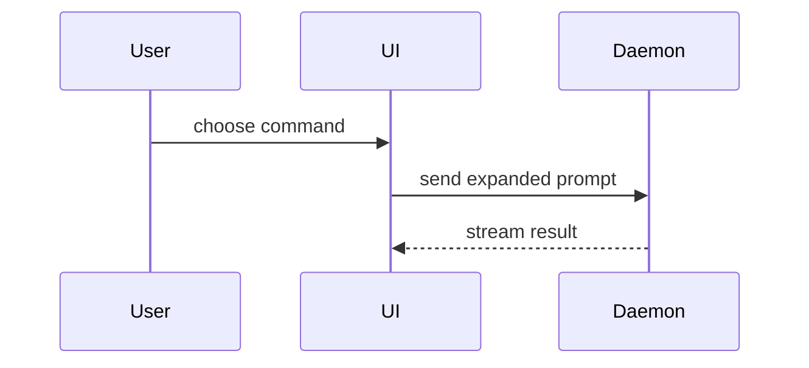

使用以下模板编写 PR 正文：

```markdown
## Summary

<图表、diff 草图或目录树>

## Evidence

- **Before:** <截图/输出/失败的测试运行>
  **After:** <截图/输出/通过的测试运行>

## Merge Danger

**Door:** <单向门或双向门>

<可选：说明>

**Blast Radius:** <一个词的描述>

<可选：合并后可能产生的影响>
```

## 各区块要求

跳过所有开场白，正文保持简短。使用 `GLOSSARY.md` 中的用户领域语言。

### Summary

选择能够清晰说明关键变化的最小视图。

- 用伪代码展示逻辑或算法：

```text
on(save)
  if content is unchanged
    return cached result
  write new content
  return fresh result
```

- 用调用树展示运行时控制流：

```text
submitForm
  createSession
    persistPrompt
    launchAgent
  navigateToSession
```

- 用组件树展示 UI 结构，并包含重要的状态和 module 边界：

```text
<SessionPage> (apps/example/src/routes/session.tsx)
  useSessionEvents()
  <SessionToolbar>
    <RunSkillButton> (packages/ui)
```

- 用浅层目录树展示文件职责或大范围重构：

```text
src/
├── commands/       # parses user actions
├── sessions/       # owns session state
└── transport/      # sends API requests
```

- 用 Mermaid 展示组件交互、控制流或数据流：



- 当重点在于变化本身，且周边结构已经存在时，使用 `diff`。让 diff 的形状匹配主题。

组件变化：

```diff
 <SessionPage>
   useSessionEvents()
   <SessionToolbar>
+    <RunSkillButton />
   <SessionTimeline>
+    <SkillResultCard />
```

文件布局变化：

```diff
 src/
 ├── commands/
+│   └── show-me.ts       # expands the slash command
 ├── sessions/
-└── transport.ts
+└── transport/
+    ├── client.ts
+    └── stream.ts
```

调用树或调用栈变化：

```diff
 submitForm
   createSession
     persistPrompt
+    expandSkillMention
     launchAgent
-  navigateToSession
+  navigateToSession
+    subscribeToEvents
```

状态或控制流变化：

```diff
 on(save)
-  write content
+  if content is unchanged
+    return cached result
+  write new content
+  invalidate cache
```

- 当大部分内容都是新的、遗漏上下文会隐藏所有权或顺序，或者用户需要一个可复制的目标形态时，展示完整代码块：

```ts
function expandSkill(command: string): string {
  const skillName = command.slice(1);
  return `use the ${skillName} skill`;
}
```

#### 指南

将每个视觉内容放在它所支撑的简短文字旁边。只保留回答用户当前问题或解决当前讨论选项所必需的调用、文件、props、状态和边界。

可以使用其中一种，也可以使用多种，但通常不需要全部使用。依靠判断，不要让信息淹没用户。

### Evidence

提供变化有效的具体证据，并展示 before 和 after。

如果环境支持且变化是视觉上的，截图是最高等级的证据。

基于执行的证据次之，例如测试结果和控制台输出。用伪代码展示现在会失败和通过的确切测试。

### Merge Danger

说明这是单向门还是双向门。双向门可以撤回，单向门不能。容易回滚的 PR 风险更低。涉及破坏性操作或难以逆转决策的变化属于单向门。

爆炸半径是该 PR 所引入变化的潜在影响或作用范围。考虑所有可能性，例如布局偏移、下游消费者破坏、移动端响应问题等。
